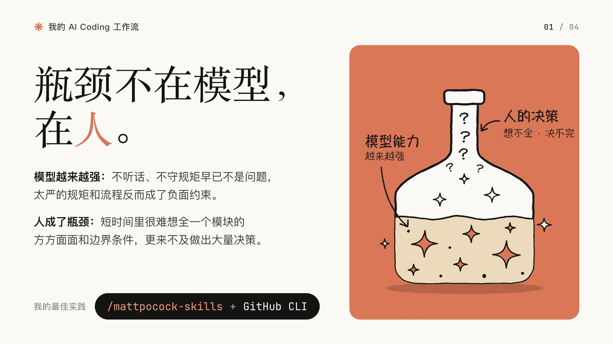
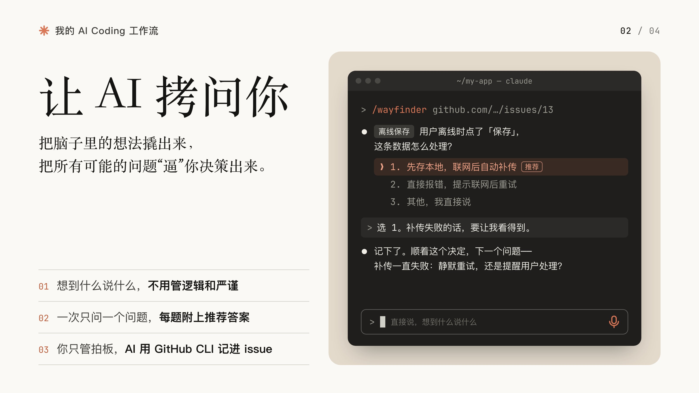
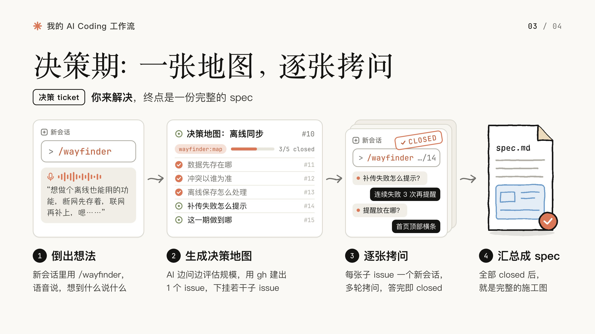
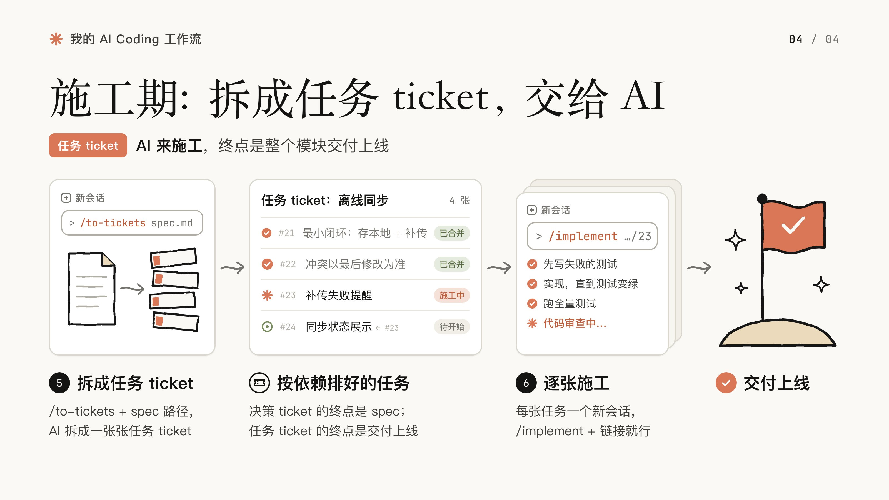
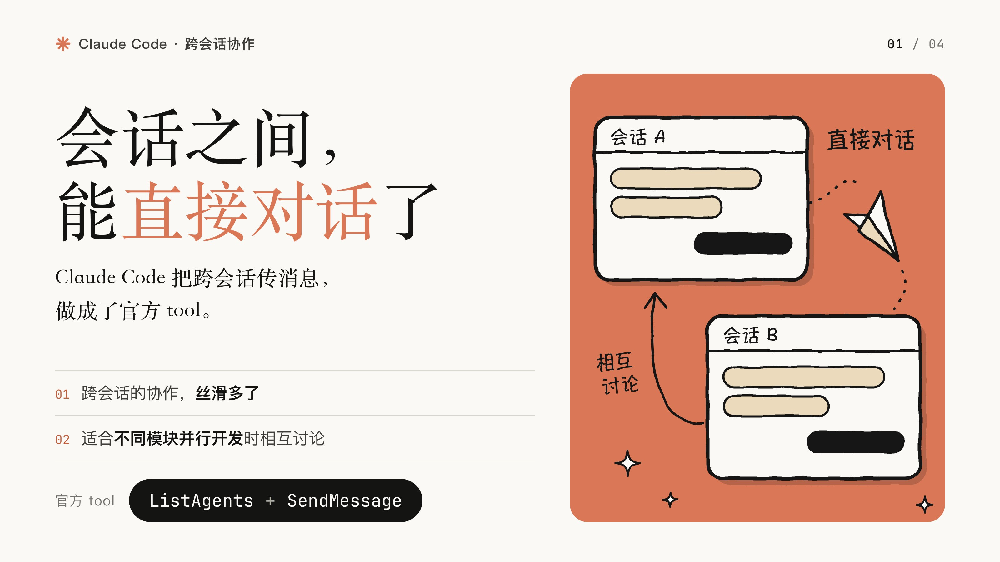
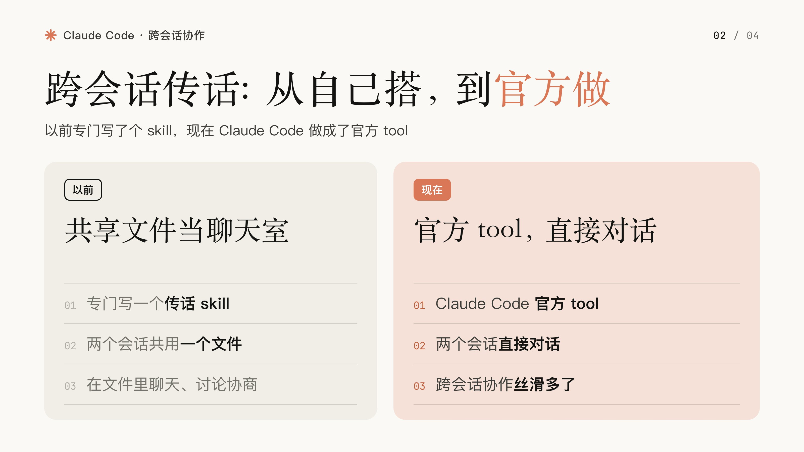
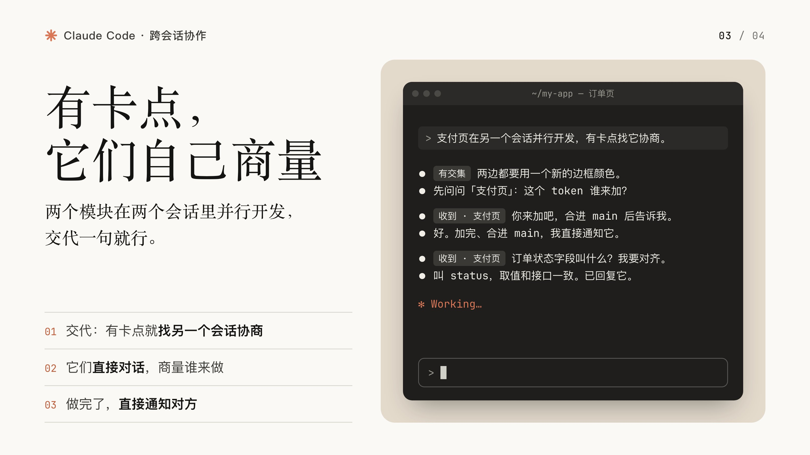
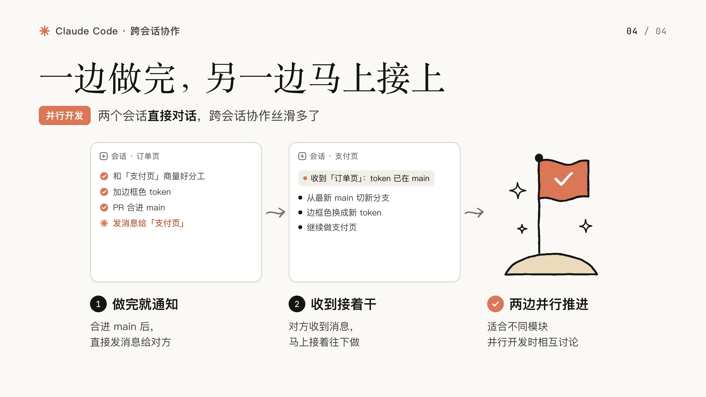

# Tweet images

把文字变成能讲清流程和技术细节的配图。

一个面向技术分享的 Agent Skill。用流程图、终端示例、代码改动和方案对比，呈现步骤、依赖与实现细节。米白底、陶土橙、衬线标题与手绘插画，适合开发教程、AI Coding 实践和工作流分享。

## 效果示例

### AI Coding 工作流

从想法、决策到任务实施，把一段长文拆成四张图。[查看原推文](https://x.com/lxxbbb_bonnie/status/2104180881455796669)

| 01 · 开篇观点 | 02 · 交互示例 |
| --- | --- |
| [](examples/published/ai-coding-workflow/01.jpg) | [](examples/published/ai-coding-workflow/02.jpg) |
| **03 · 决策流程** | **04 · 实施流程** |
| [](examples/published/ai-coding-workflow/03.jpg) | [](examples/published/ai-coding-workflow/04.jpg) |

### 跨会话协作

用方案对比、终端对话和流程图，解释多个会话如何协作。[查看原推文](https://x.com/lxxbbb_bonnie/status/2106987761400197152)

| 01 | 02 |
| --- | --- |
| [](examples/published/cross-session-collaboration/01.jpg) | [](examples/published/cross-session-collaboration/02.jpg) |
| **03** | **04** |
| [](examples/published/cross-session-collaboration/03.jpg) | [](examples/published/cross-session-collaboration/04.jpg) |

## 安装

```bash
npx skills add Justlxb0124/tweet-images
```

需要 Node.js/npm 运行安装命令；出图需要 Python 3.8+ 和 Google Chrome。已在 macOS 验证。

## 使用

把文案交给 agent，并说明你想讲清楚什么：

```text
用 tweet-images 给下面这段技术分享做 4 张配图。
突出流程中的步骤、依赖和关键技术细节。

[粘贴文字]
```

默认四张 16:9 图片，数量可调整；定稿输出 3200×1800 PNG。支持流程、对比、终端与插画版式，可继续用自然语言修改。

[出图流程](SKILL.md) · [字段参考](references/spec-format.md) · [示例 JSON](references/example-spec.json)

## 许可

[MIT](LICENSE) · 作者 [Lxxbbb](https://x.com/lxxbbb_bonnie)
